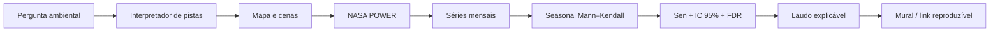

<div align="center">

# 🌍 Earth Sleuths

### O planeta deixa pistas. A ciência revela tendências.

Uma experiência investigativa para transformar perguntas ambientais em evidências estatísticas — com dados da NASA POWER, mapas interativos e um laudo que explica o que os números realmente sustentam.

<p>
  <a href="#-comece-a-investigar">Comece a investigar</a> ·
  <a href="#-como-funciona">Como funciona</a> ·
  <a href="#-arquitetura">Arquitetura</a> ·
  <a href="#-segurança">Segurança</a>
</p>

<br />


</div>

---

## 🧭 A missão

**Earth Sleuths** é um laboratório visual para investigar mudanças ambientais locais.

Você escolhe uma pergunta, aponta uma região no mapa e seleciona as pistas que deseja cruzar. O sistema busca séries mensais da **NASA POWER**, calcula tendências e devolve um dossiê legível — com contexto, incerteza, procedência e limites da evidência.

> Não é uma máquina de confirmar suspeitas.  
> É uma ferramenta para descobrir o que os dados permitem afirmar.

## 🎞️ Pitch decks

Apresentação do projeto disponível nos dois idiomas:

- 🇬🇧 [Earth Sleuths — Pitch Deck (EN)](./docs/pitch-deck/Earth-Sleuth-Pitch-Deck-EN.pdf)
- 🇧🇷 [Earth Sleuths — Pitch Deck (PT)](./docs/pitch-deck/Earth-Sleuth-Pitch-Deck-PT.pdf)

## ✨ O que você pode fazer

| Recurso | O que acontece |
| --- | --- |
| 🕵️ **Investigar** | Escreva uma pergunta em linguagem natural ou carregue um caso de demonstração. |
| 🗺️ **Escolher cenas** | Selecione coordenadas no mapa ou use atalhos de regiões. |
| 🧩 **Cruzar pistas** | Compare temperatura, precipitação, umidade, radiação, vento e outras variáveis do catálogo. |
| ⚖️ **Duas Cenas** | Coloque duas regiões lado a lado e só declare contraste quando os dois sinais forem significativos. |
| 📈 **Ler o laudo** | Veja inclinação de Sen, p-valor, q-valor FDR, intervalo de confiança e dados faltantes. |
| 🎯 **Explorar os ODS** | Relacione a pista investigada aos Objetivos de Desenvolvimento Sustentável. |
| 🧷 **Salvar no mural** | Gere um link reproduzível que reabre a mesma ficha de investigação. |
| 🌐 **Trocar o idioma** | Alterne entre Português e English diretamente na interface. |

<details>
<summary><strong>🔬 O motor estatístico, sem caixa-preta</strong></summary>

O backend aplica o **Seasonal Mann–Kendall** com correção de autocorrelação entre meses de **Hirsch & Slack (1984)** e estima a inclinação sazonal de **Sen**. Quando várias pistas ou cenas são testadas juntas, o laudo também calcula o ajuste de múltiplas comparações por **Benjamini–Hochberg (FDR)**.

As regras narrativas são explícitas:

- **Tendência real (RN01):** `p < 0,05` e o IC 95% da inclinação não cruza zero.
- **Pode ser ruído (RN02):** `p ≥ 0,05` ou o IC 95% cruza zero.
- **Dados insuficientes (RN03):** menos de 15 anos, mais de 20% de meses ausentes ou menos de 144 meses válidos.
- **Rastreabilidade (RN04):** números narrados precisam estar lastreados no JSON retornado pela API.

</details>

## 🚀 Comece a investigar

### Pré-requisitos

- **Python 3.11+**
- **Node.js 20+**
- npm

### Instalação no Windows

No PowerShell, na pasta do projeto:

```powershell
cd "C:\Users\Karine Duarte\Desktop\Projetos Pessoais\earth-sleuths"
py -m pip install -r requirements-dev.txt
npm install
```

> ℹ️ Neste ambiente, o Python é chamado pelo launcher `py`. Se `python` funcionar no seu PATH, ele também pode ser usado.

### ▶️ Inicie a aplicação

Abra **dois terminais** na raiz do projeto.

**Terminal 1 — API FastAPI:**

```powershell
py -m uvicorn api.index:app --reload --port 8000
```

**Terminal 2 — frontend Next.js:**

```powershell
npm run dev
```

Depois, abra **[http://localhost:3000](http://localhost:3000)**.

O Next.js encaminha `/api/*` para a API local em `http://127.0.0.1:8000`.

<details>
<summary><strong>🛰️ Baixar dados reais para a cópia de reserva</strong></summary>

Antes de uma apresentação ou deploy, execute:

```powershell
py scripts\fetch_nasa_cases.py
```

O script atualiza `api/_lib/data/demo_cases.json`. Esse arquivo permite demonstrar casos salvos quando a API da NASA estiver indisponível.

</details>

<details>
<summary><strong>🧪 Testes e verificações</strong></summary>

```powershell
# Motor estatístico e API
py -m pytest

# Tipagem do frontend
npm run typecheck

# Build de produção
npm run build
```

Ou use os atalhos da pasta [`windows/`](./windows/):

- `1_instalar.bat` — instala Python e npm.
- `2_baixar_dados_nasa.bat` — prepara os dados de demonstração.
- `3_iniciar_app.bat` — inicia API, frontend e navegador.
- `4_testar_motor.bat` — executa os testes estatísticos.

</details>

## 🧠 Como funciona



### Fluxo de uma investigação

1. **Pergunte.** Escreva o que deseja descobrir ou escolha um preset.
2. **Posicione.** Ajuste a Cena A; ative a Cena B para comparar duas regiões.
3. **Selecione pistas.** O interpretador sugere parâmetros do catálogo.
4. **Escolha o período.** O intervalo disponível vai de 1981 a 2025.
5. **Execute.** A API busca os dados, analisa cada pista e devolve o dossiê.
6. **Interrogue a evidência.** Abra os detalhes, confira a procedência e salve a ficha.

## 🏗️ Arquitetura

```text
earth-sleuths/
├── src/
│   ├── app/                 # Página, layout e estilos globais
│   ├── components/          # Mapa, gráficos, modal de evidências e ODS
│   ├── lib/                 # Catálogo e interpretação de perguntas
│   └── types/               # Tipos compartilhados do frontend
├── api/
│   ├── index.py             # API FastAPI e endpoints
│   └── _lib/
│       ├── nasa_power.py    # Cliente NASA POWER e cache
│       ├── stats_engine.py  # Motor estatístico
│       └── data/            # Casos de demonstração
├── scripts/                 # Preparação de dados
├── tests/                   # Testes de API e estatística
└── windows/                 # Atalhos para Windows
```

### Endpoints locais

| Método | Endpoint | Para que serve |
| --- | --- | --- |
| `GET` | `/api/health` | Confere se o motor está respondendo. |
| `GET` | `/api/catalog` | Lista as pistas disponíveis. |
| `POST` | `/api/analyze` | Executa uma investigação completa. |

## 🔐 Segurança

- Nunca commite `.env`, `.env.*` ou chaves reais.
- Use [`.env.example`](./.env.example) como modelo — sem preencher valores no commit.
- Restrinja chaves de browser por domínio e pelas APIs necessárias.
- Rotacione imediatamente qualquer chave que tenha sido publicada.
- Para deploy, use os **Environment Variables** da Vercel ou o gerenciador de segredos do provedor.

> Se uma chave já apareceu em um repositório público, adicioná-la ao `.gitignore` não basta: ela precisa ser revogada/rotacionada no provedor e removida do histórico.

## ☁️ Deploy na Vercel

```powershell
npx vercel
npx vercel --prod
```

O [`vercel.json`](./vercel.json) encaminha `/api/*` para `api/index.py`. Antes do deploy:

1. Execute `py scripts\fetch_nasa_cases.py`.
2. Confira os casos no modo de cópia salva.
3. Configure as variáveis de ambiente na Vercel.
4. Verifique `/api/health` no preview.

## 🌱 Contexto e créditos

Os dados são do **NASA Langley Research Center (LaRC) POWER Project**, financiado pelo NASA Earth Science/Applied Science Program.

Projeto independente, sem endosso da NASA.

Desenvolvido para transformar curiosidade ambiental em investigação pública, verificável e visual.

<div align="center">

### 🌎 Pergunte melhor. Observe os dados. Siga as pistas.

</div>
